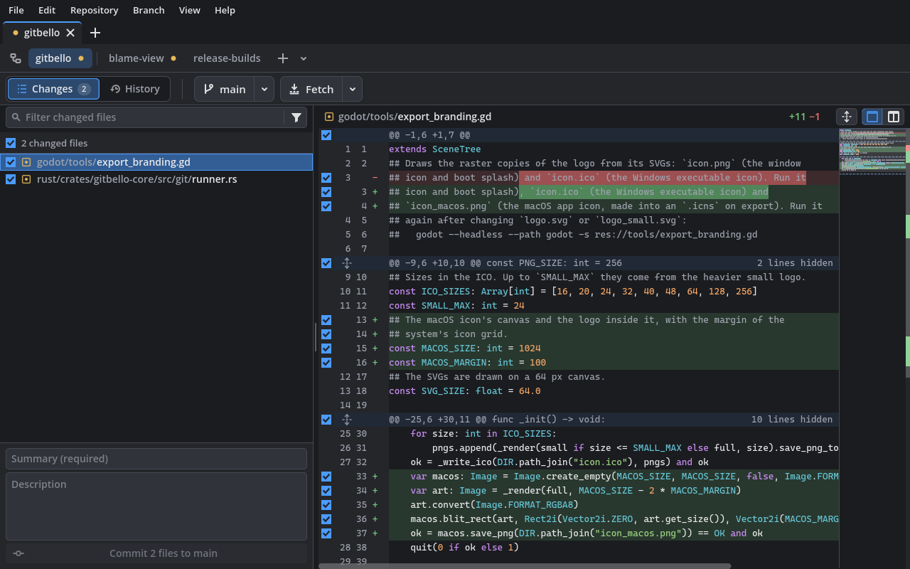

<p align="center"></p>

<h1 align="center">gitbello</h1>

<p align="center"><b>Every repository and worktree, within reach.</b><br>
A fast, open-source Git GUI for people who juggle many repositories at once.</p>

<p align="center">
  <a href="https://github.com/caleb-tognoli/gitbello/releases/latest"><b>Download</b></a> ·
  <a href="#features">Features</a> ·
  <a href="CHANGELOG.md">Changelog</a> ·
  <a href="#building-from-source">Build from source</a>
</p>

<p align="center">
  
  
  
  
</p>

<picture>
  <source media="(prefers-color-scheme: light)" srcset="docs/screenshot-light.png">
  
</picture>

gitbello is built for a day spent across many repositories and worktrees. Each repository
has a tab, its worktrees sit in a strip of chips inside it, and live status shows
everywhere, so you see at a glance what changed where. It runs on the `git` you already
have, with a native Rust core and a UI that stays quiet when you aren't using it.

## Download

Get the latest build from [Releases](https://github.com/caleb-tognoli/gitbello/releases/latest).
gitbello needs **git 2.40 or newer**.

- **Windows:** run `gitbello-…-windows-setup.exe` (no administrator rights needed). If git
  is missing or too old, the installer offers to download and install Git for Windows.
  Or use the `.zip` without installing. The builds aren't signed, so the first time
  Windows may say it protected your PC: click **More info**, then **Run anyway**.
- **macOS:** unzip and move gitbello to Applications. The app isn't notarized by Apple,
  so the first time macOS won't open it: click **Done**, open **System Settings > Privacy
  & Security**, and click **Open Anyway** next to gitbello. Or, in Terminal:
  `xattr -dr com.apple.quarantine /Applications/gitbello.app`. Get git with
  `xcode-select --install` or [Homebrew](https://brew.sh) (`brew install git`).
- **Linux (x86_64):** extract the archive and run `./install.sh`, which adds the launcher
  and the `gitbello` command (`./install.sh --uninstall` removes it). Install git with
  your package manager.

## Features

**Repositories and worktrees**
- **Home** lists every repository you've added, with branch, changes and ahead/behind for
  each. Clone, create, add a folder, or scan a folder for all the repositories inside.
- **Worktree strip:** each worktree is a chip with its branch, changes and state;
  Ctrl+1…9 switch between them.
- **New task** makes a branch and its worktree in one step. **Clean up merged** removes
  worktrees whose branch is merged or gone.

**Committing**
- Tick files, hunks or single lines. The commit is built from your selection in a
  temporary index, so whatever you staged elsewhere stays as it was.
- Amend, discard with Undo, and undo the last commit while it isn't pushed.

**Reading code and history**
- Unified and side-by-side diffs with syntax highlighting, changed words and a minimap.
- A fast commit graph for the current branch or all branches, with search by subject,
  author or hash.

**Shelves** are stashes tied to a branch: shelve, restore, rename or discard them, whole
or a file at a time. Switching branch with changes offers to shelve them and to bring
them back when you return.

**Sync, merge and conflicts**
- Fetch, pull and push with progress, cancel, auto-fetch, and errors that come with a fix.
- Merge shows whether there will be conflicts before it starts. The resolver works in
  the diff pane, unified or side by side, with the base on demand.
- Cherry-pick from the graph; continue, skip or abort merges, cherry-picks and rebases.
- Branches, tags and remotes.

**Everywhere:** a command palette, menus and rebindable shortcuts for every action; light
and dark themes that follow the system, with your accent colour; English and Italian
(Settings > Interface > Language); open in your editor or terminal; and the log of every
git command gitbello ran.

See the [changelog](CHANGELOG.md) for everything in each release.

## Building from source

Requirements:

- Rust via rustup (the version pinned in `rust-toolchain.toml` installs automatically)
- Godot **4.7.x** (standard build, not .NET)
- git **2.40** or newer

Point `GODOT` at the Godot executable, or put `godot` on your `PATH`:

```sh
export GODOT=/path/to/Godot_v4.7.2-stable   # PowerShell: $env:GODOT = "C:\path\to\Godot_v4.7.2-stable_win64.exe"
```

Then, from the repository root:

```sh
cargo xtask run      # build the native library and launch the app
cargo xtask check    # fmt + clippy + tests
cargo xtask smoke    # headless Godot smoke tests
```

`cargo xtask help` lists every task. Release builds are made by
[the Release workflow](.github/workflows/release.yml) when a `v*` tag is pushed.

### Layout

- `rust/crates/gitbello-core`: all git logic, models and scheduling (no Godot dependency)
- `rust/crates/gitbello-gdext`: thin GDExtension bindings
- `rust/crates/gitbello-cli`: headless dev harness for the core
- `rust/xtask`: build and test tasks
- `godot/`: the Godot project (typed GDScript UI)
- `packaging/`: the Windows installer and the Linux launcher

The design and roadmap are in [docs/PLAN.md](docs/PLAN.md); contributor rules are in
[AGENTS.md](AGENTS.md).

## License

[MIT](LICENSE)
